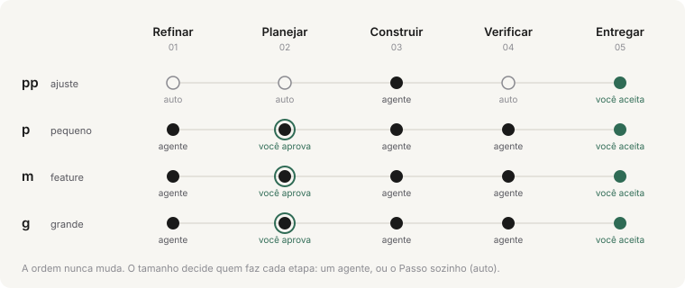

<picture>
  <source media="(prefers-color-scheme: dark)" srcset="docs/assets/logo-dark.svg">
  
</picture>

**Passo a passo, com você aprovando.** O Passo conduz um agente de IA (Claude Code ou GitHub Copilot) do pedido à entrega, em cinco etapas com nomes comuns. O agente faz uma coisa por vez. Quem decide o próximo passo, roda as checagens e faz os commits é o Passo, e nada é entregue sem o seu ok.

`Rust` · `um binário de 1,8 MB` · `macOS e Linux` · `Claude Code e Copilot` · `pt-BR`

---

## Por que

Modelos baratos erram menos quando alguém carrega a estrutura por eles. O Passo carrega:

- **Uma tarefa por vez**, com o papel, as instruções do tamanho, só o contexto necessário e o modelo exato do que entregar.
- **Erros precisos**: uma entrega inválida volta com o campo errado ("`passos[2].titulo` está vazio"), não com "inválido".
- **O Passo roda as checagens**: o agente nunca diz que os testes passaram. Uma falha volta para ele com a saída; na terceira, o Passo chama você.
- **Um plano forte, uma construção leve**: o planejador e o revisor pedem o nível `forte`; o refinador e o construtor, o `leve`.
- **Evidência conferida**: cada critério que o revisor diz atendido precisa citar um arquivo, uma linha ou um teste que existam; o Passo confere no repositório.
- **O modelo forte só onde o barato travou**: um passo que falha sobe para o nível forte na tentativa seguinte (`passo-construtor-forte`), antes de chamar você.
- **O agente não desiste**: o hook de Stop não deixa ele parar na vez dele.

## As etapas

| Etapa         | Quem                 | Termina com                                                         |
| ------------- | -------------------- | ------------------------------------------------------------------- |
| **Refinar**   | refinador            | o pedido refinado: entendimento, escopo, suposições e perguntas com opções |
| **Planejar**  | planejador           | critérios de aceite e passos pequenos, cada um com o teste que o prova, o comando que o roda e os critérios que atende; critério sem passo é recusado. **Você aprova** |
| **Construir** | construtor           | um passo por vez; o Passo roda as checagens e faz um commit por passo |
| **Verificar** | o Passo e o revisor  | a suíte completa, depois cada critério conferido com evidência     |
| **Entregar**  | o Passo              | o resumo com o grau de prova. **Você aceita**, e o branch é juntado |

### O tamanho decide quem faz cada etapa

<picture>
  <source media="(prefers-color-scheme: dark)" srcset="docs/assets/track-dark.svg">
  
</picture>

A ordem nunca muda e nenhuma etapa some. Num `pp` (trocar um texto), o Passo refina, planeja e verifica sozinho, sem gastar tokens: o agente só constrói e você só aceita. Os limites do `pp` são conferidos no diff, não na opinião do agente: passou de 3 arquivos ou 120 linhas, ou tocou numa área sensível, o run para e você decide.

### Você decide só o que importa

Cada dúvida chega com opções e uma recomendada. Você responde no chat do agente, no terminal ou no painel:

```text
ok                  aprova; perguntas sem resposta ficam com a recomendada
ok 1b               opção B na pergunta 1
ok 2=suas palavras  responde com as suas palavras
não: o que mudar    recusa; o pedido volta para o refinamento
aceito              aceita a entrega (no chat, um ok solto não basta: aceitar junta o branch)
```

Responder no chat funciona porque o hook de prompt só dispara com o que **você** digita. O agente, por sua vez, não consegue rodar `passo ok`: a trava nega pelo hook, e a própria CLI recusa `ok`, `no`, `change`, `size` e `stop` quando roda no ambiente do agente (o Claude Code marca esse ambiente, inclusive o dos subagentes, que não passam pelos hooks). Se você quiser rodar um desses comandos de propósito no terminal do agente, use `PASSO_DEV=1 passo ok`.

## Começar

A partir do código (Rust 1.89 ou mais novo):

```bash
cargo install --git https://github.com/JonathanSantos/passo passo-cli
```

Depois da primeira release, também pelo instalador, que baixa o binário para macOS ou Linux e confere o checksum:

```bash
curl -fsSL https://raw.githubusercontent.com/JonathanSantos/passo/main/install.sh | sh
```

No projeto (um repositório git com pelo menos um commit):

```bash
passo init --agent claude
```

Use `--agent copilot`, ou `--agent ambos`. O `init` detecta a stack, escolhe as checagens e instala a skill, os quatro agentes e os hooks. Commite os arquivos, abra uma sessão nova do agente e peça:

> com o passo, adicione prioridade às tarefas

Para acompanhar, abra o painel em outro terminal:

```bash
passo ui
```

## O painel

`passo ui` abre um painel local: o trilho das etapas, quem tem a vez, o plano e as perguntas (com aprovar e recusar ali mesmo), as checagens com a saída, as mudanças no pedido, a atividade do agente em tempo real e as métricas. `passo report` gera o mesmo painel num `.html` único, que abre offline e pode ir anexado num PR. A entrega já gera o relatório sozinha.

## Auditoria e métricas

- **Tudo vira evento** num log com cadeia de SHA-256: cada ação do agente, cada negação da trava, cada decisão sua (e por onde ela veio: chat, terminal ou painel). `passo log --verify` acusa qualquer linha alterada ou apagada.
- **O log fica ancorado no git.** Cada commit do Passo leva o hash do último evento (`Passo-Audit:`), e na entrega (ou no `stop`) o log vai commitado em `.passo/audit/<run>/`, junto com o código. Um log reescrito ou encurtado até o último commit não bate com o histórico, e o `verify` diz.
- **Mudanças no pedido** ficam registradas com quem, quando e o antes e depois: respostas, recusas, `passo change`, trocas de tamanho e cada versão do plano (`plan-v1.json`, `plan-v2.json`…).
- **`passo stats`** mostra o que custou: tempo por etapa, **quantas vezes o dev foi chamado e quanto tempo o run esperou por ele**, tokens por etapa e por modelo, tentativas falhas, entregas inválidas e negações da trava.

## Comandos

| Do agente                         |                                                          |
| --------------------------------- | -------------------------------------------------------- |
| `passo start "<pedido>" --size m` | começa um run (`pp`, `p`, `m`, `g`)                      |
| `passo next`                      | a tarefa da vez                                          |
| `passo done <arquivo\|"resumo">`  | entrega a etapa (`--vazio`, `--nota "…"`)                |
| `passo ask "<pergunta>" "<opção>"…` | pergunta ao dev, a recomendada primeiro                |
| `passo map`                       | começa o mapeamento do projeto (entregue com `passo done`) |

| Do dev                            |                                                          |
| --------------------------------- | -------------------------------------------------------- |
| `passo ok [1b "2=…"]`             | aprova, responde, segue                                  |
| `passo no "<o que mudar>"`        | recusa o plano ou a entrega                              |
| `passo change "<mudança>"`        | muda o pedido no meio do run                             |
| `passo size <t>`                  | troca o tamanho                                          |
| `passo stop`                      | encerra (o trabalho fica no branch)                      |
| `passo map --cancel`              | cancela um mapeamento em andamento                       |

| Ver                               |                                                          |
| --------------------------------- | -------------------------------------------------------- |
| `passo status` · `plan` · `runs`  | onde está, o plano e as decisões, os runs                |
| `passo log [--verify]` · `stats`  | auditoria e métricas                                     |
| `passo ui` · `report` · `doctor`  | painel, relatório, configuração                          |

## Estender

Tudo se estende com arquivos em `.passo/`, sem tocar no binário: você muda **como** uma etapa é feita, nunca **se** ela acontece.

```yaml
# .passo/passo.yaml
extends: [preset:rust, ~/time/passo.yaml]

sizes:
  p:
    verificar: auto
```

```markdown
<!-- .passo/agents/construtor.md -->
---
extends: construtor
---
Erros de domínio usam `thiserror`; nada de `unwrap()` fora de testes.
```

Agentes, etapas, checklists de domínio, tamanhos e modelos: veja [`docs/EXTENDER.md`](docs/EXTENDER.md).

**O mapa do projeto.** Peça ao agente "com o passo, mapeie o projeto" (ou rode `passo map`): um agente explorador lê o projeto, só lendo, e entrega um mapa com as áreas, as práticas e as bibliotecas. O Passo confere cada campo no disco (os caminhos casam arquivos rastreados, as fontes existem, nada mudou no projeto durante o mapeamento) e grava `.passo/map/` em Markdown, para você commitar e editar à mão quando quiser.

A cada etapa, o Passo mostra só a parte do mapa que interessa: em Refinar, as áreas citadas no pedido; em Planejar, as que cobrem os arquivos do pedido, mais as que elas usam; em Construir, só a área do passo. O mapa é opcional: sem ele, o Passo mostra a árvore de pastas que ele mesmo gera.

## Simulação com modelos baratos

O mesmo pedido de tamanho `m` no projeto de exemplo ([`examples/tarefas`](examples/tarefas)), conduzido de ponta a ponta por um agente que só conhecia a skill do Passo. O dev seguiu uma regra fixa: aprovar as recomendadas e aceitar a entrega se as checagens passassem. As entregas foram julgadas por uma suíte de aceite escondida, que nenhum agente viu.

| | Haiku 5.5 | Sonnet 5.5 |
| --- | --- | --- |
| **Suíte escondida** | **6/6** | **6/6** |
| Testes do projeto no fim | 10 | 14 |
| Grau de prova | forte | forte |
| Perguntas ao dev | 1 (formato da listagem) | 0 (tudo virou suposição explícita) |
| Vezes do dev | 3 (plano, entrega, entrega depois do ajuste) | 2 (plano, entrega) |
| Passos | 3, mais 1 de ajuste | 4 |
| Tentativas que falharam · entregas inválidas | 0 · 0 | 0 · 0 |
| Tempo total | 4min 46s | 2min 28s |
| Tokens por etapa (refinar · planejar · construir · verificar · entregar) | 6,1k · 9,5k · 29,7k · 17,1k · 7,7k | 4,8k · 6,4k · 16,8k · 4,6k · 3,1k |
| Tokens no run · chamadas ao modelo | 70,1k · 31 | 35,7k · 15 |

O que a simulação mostrou:

- **O modelo barato chegou ao mesmo resultado.** O Haiku, fazendo todas as etapas sozinho (inclusive planejar e revisar, que por padrão pedem o nível forte), entregou o pedido inteiro, com os mesmos casos de borda que o Sonnet, e passou na suíte escondida.
- **O revisor barato achou um problema real.** Um passo do Haiku commitou um `tarefas.json` gerado por teste. O revisor apontou, tentou apagar na Verificação e foi barrado (a etapa é só leitura; quem barrou foi a conferência pelo git, porque subagentes não passam pelos hooks). O dev recusou a entrega com uma frase, e o ajuste virou um passo de correção. Esse caso virou uma melhoria no Passo: um passo que muda arquivos fora do plano agora fica anotado para o revisor e para o dev.
- **O custo para o dev ficou em 2 a 3 decisões**, uma delas uma pergunta com a resposta recomendada pronta.
- O Haiku gastou cerca do dobro de tokens do Sonnet neste pedido, numa fração do preço por token.

Tokens são os faturáveis (entrada, saída e escrita de cache) que o Passo leu das transcrições e atribuiu a cada etapa pelo horário; a leitura de cache aparece à parte em `passo stats`. Uma ressalva: as transcrições de subagentes registram poucos tokens de saída para o volume de código escrito, então trate a saída como um piso. Foi uma rodada: é indício, não prova. Para repetir com N rodadas por modelo, use `examples/simulacao/rodar.sh` e gere esta tabela de novo com `examples/simulacao/tabela.js` (veja [`examples/simulacao`](examples/simulacao)); a tabela deve sair dos scripts, não ser escrita à mão.

## Do MOHs e do SIMPLE para cá

O Passo junta o que mais rendia nos dois harnesses anteriores: o fluxo conduzido por código, a trava por hooks, as decisões com opções e recomendação, as checagens rodadas pelo harness, um commit por passo, o grau de prova da entrega, o log com painel ao vivo e o relatório. O que mudou:

- **Sem analogias.** Nada de climb, belay ou seal: o dev não precisa aprender um vocabulário antes de usar.
- **Nenhuma etapa some.** O modo rápido do SIMPLE pulava etapas. Aqui, o tamanho decide se uma etapa é feita por um agente ou pelo Passo sozinho (`auto`), e a auditoria mostra sempre as cinco.
- **Aprovar pelo chat**, sem abrir outro terminal.
- **Auditoria com cadeia de hashes e ancorada no git**, e o histórico das mudanças no pedido.
- **Métricas do custo para o dev**, além do custo em tokens.
- **Um binário Rust** em vez de Node, com as plataformas atrás de adapters.
- Ficaram de fora os testes escondidos do construtor, os vários revisores e o daemon: custam caro e rendem pouco com modelos baratos.

## Estado

- **Testado de ponta a ponta**: o fluxo inteiro, nos quatro tamanhos, com git de verdade (branch, commit por passo, merge, `stop`), a validação das entregas, a auditoria, as métricas, o painel e a simulação com Haiku e Sonnet descrita acima.
- **Ainda não testado ao vivo**: os hooks numa sessão real do Claude Code (a trava, o Stop e a aprovação pelo chat) e o formato de hooks do Copilot no VS Code. Esses caminhos estão cobertos por testes com payloads sintéticos; a simulação usou subagentes, que não passam pelos hooks. O formato do Copilot é o ponto mais incerto, e por isso fica isolado no adapter. Também não rodaram ao vivo: o aviso do orçamento de ações como `additionalContext` num `PreToolUse` permitido (o canal segue a referência atual de hooks do Claude Code), a recusa dos comandos do dev dentro de um subagente real (testada com o binário e um ambiente sintético) e o próprio `examples/simulacao/rodar.sh`, que gasta tokens da conta.

## Documentos

- [`docs/ARQUITETURA.md`](docs/ARQUITETURA.md): crates, o fluxo como função pura, auditoria, métricas, padrões e decisões.
- [`docs/EXTENDER.md`](docs/EXTENDER.md): `extends`, agentes, etapas, tamanhos, checklists, modelos e plataformas novas.
- [`docs/DESIGN.md`](docs/DESIGN.md): marca e design system.

## Desenvolvimento

```bash
cargo test --workspace
cargo clippy --workspace --all-targets -- -D warnings
cargo fmt --all --check
```

A CI roda em Linux e macOS. Uma tag `v*` publica binários para macOS e Linux (x86_64 e aarch64). Depois da primeira release, para instalar o Passo num workflow (ou no ambiente do Copilot coding agent), use a action do repositório:

```yaml
- uses: JonathanSantos/passo@main
```

## Licença

[MIT](LICENSE).
